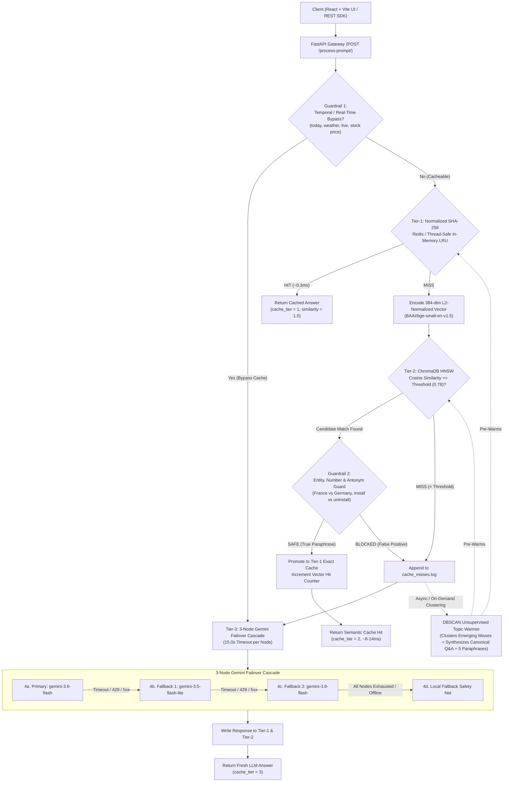

# Semantiq — 3-Tier LLM Semantic Cache for Inference Optimization

**Semantiq** is a production-grade **3-Tier Semantic Caching & Inference Optimization Engine** that sits in front of Large Language Model (LLM) APIs. By combining **Tier-1 O(1) normalized SHA-256 exact lookup**, **Tier-2 ChromaDB HNSW cosine similarity search (`BAAI/bge-small-en-v1.5`)** with **entity, number, and antonym false-positive guardrails**, and a **Tier-3 3-node Gemini failover cascade**, Semantiq eliminates **~76% of redundant LLM API calls** and reduces response latency from **~1.5s down to <15ms**.

---

## System Architecture



### ASCII Pipeline Overview

```text
[User Prompt]
     │
     ▼
┌─────────────────────────────────────────────────────────────────────────┐
│ Guardrail 1: Temporal / Real-Time Bypass Detector                       │
│ ("weather today", "live score", "current stock price") ──► Tier-3 LLM   │
└─────────────────────────────────────────────────────────────────────────┘
     │ (Static / Knowledge Query)
     ▼
┌─────────────────────────────────────────────────────────────────────────┐
│ Tier-1: O(1) Normalized SHA-256 Exact Cache (Redis / In-Memory LRU)     │
│ Lowercase + whitespace-collapsed + punctuation-trimmed key              │
│ ──► HIT (~0.3 ms): Return immediately                                   │
└─────────────────────────────────────────────────────────────────────────┘
     │ MISS
     ▼
┌─────────────────────────────────────────────────────────────────────────┐
│ Tier-2: ChromaDB HNSW Vector Index (hnsw:space = "cosine")              │
│ 384-d L2-normalized BAAI/bge-small-en-v1.5 embedding (~10 ms)           │
│   ├─ Cosine Similarity >= Threshold (default 0.78)                      │
│   └─ Guardrail 2: Entity / Number / Antonym Verification                │
│        ├─ PASS ──► Promote to Tier-1 + Return Semantic Hit (~12 ms)     │
│        └─ BLOCK ─► Prevent false cache hit (e.g. France vs Germany)     │
└─────────────────────────────────────────────────────────────────────────┘
     │ MISS or GUARD BLOCKED
     ▼
┌─────────────────────────────────────────────────────────────────────────┐
│ Tier-3: 3-Node Gemini Failover Cascade (15.0s timeout/node)             │
│   4a. Primary:    gemini-3.6-flash                                      │
│   4b. Fallback 1: gemini-3.5-flash-lite                                 │
│   4c. Fallback 2: gemini-3.8-flash                                      │
│   4d. Safety Net: Deterministic Local Knowledge Base (Zero Downtime)    │
└─────────────────────────────────────────────────────────────────────────┘
     │
     ├─► Populate Tier-1 & Tier-2 for future queries
     └─► Log miss to cache_misses.log ──► DBSCAN Proactive Topic Warmer
```

---

## Key Engineering Highlights

### 1. True Cosine HNSW Indexing & Normalized Embeddings (`BAAI/bge-small-en-v1.5`)
- Uses `BAAI/bge-small-en-v1.5` (384 dimensions) with explicit L2 normalization (`normalize_embeddings=True`) and configures ChromaDB with `metadata={"hnsw:space": "cosine"}`.
- Converts ChromaDB cosine distance $d \in [0, 2]$ directly to cosine similarity $\text{sim} = 1.0 - d$, bounded to $[0.0, 1.0]$.
- Automatic **Tier-2 $\rightarrow$ Tier-1 Promotion**: When a paraphrase hits Tier-2, the exact normalized phrasing is promoted into Tier-1 so subsequent identical requests resolve in **<1ms** without re-computing embeddings.

### 2. Entity, Number & Antonym False-Positive Guardrails + Temporal Bypass
Pure cosine similarity frequently produces high scores ($> 0.85$) for structurally identical sentences that ask opposite or distinct factual questions. Semantiq enforces two deterministic guardrails:
- **Entity / Number / Antonym Guard (`check_semantic_guardrails`)**:
  - Rejects candidate semantic matches when proper nouns/entities differ (*"What is the capital of France?"* vs. *"What is the capital of Germany?"*).
  - Rejects matches when numeric constraints differ (*"Top 5 Python libraries"* vs. *"Top 10 Python libraries"*).
  - Rejects matches across directional antonym pairs (*"How do I install Docker?"* vs. *"How do I uninstall Docker?"*, `enable`/`disable`, `start`/`stop`, `encrypt`/`decrypt`).
- **Temporal / Real-Time Bypass (`is_temporal_query`)**:
  - Detects time-sensitive tokens (`today`, `right now`, `current weather`, `live score`, `latest news`, `stock price`) and routes directly to Tier-3 so stale cached answers are never served.

### 3. Unsupervised DBSCAN Cold-Start Topic Clustering & Proactive Cache Warming
- Every cache miss is logged to `cache_misses.log`.
- The **Proactive Topic Warmer** (`POST /cache/proactive-warm` / `proactive_cacher.py`) embeds recent misses and runs **scikit-learn `DBSCAN(eps=0.48, min_samples=3, metric="cosine")`** to discover emerging user topic clusters automatically.
- For the densest cluster, it synthesizes a canonical question, authoritative answer, and 5 natural paraphrases, warming both Tier-1 and Tier-2 before future traffic spikes arrive.

### 4. 3-Node Gemini Failover Cascade with 15s Per-Node Timeouts & Circuit Breaker
- Executes direct REST calls with a configurable `LLM_TIMEOUT_SECONDS=15.0` per node across:
  1. **4a. Primary:** `gemini-3.6-flash`
  2. **4b. Fallback 1:** `gemini-3.5-flash-lite`
  3. **4c. Fallback 2:** `gemini-3.8-flash`
  4. **4d. Local Fallback Safety Net:** Curated technical responses so the system operates with 100% availability even offline or without API keys.
- Returns a full `cascade_attempts` trace in `pipeline_trace` so users can inspect per-node status codes and latencies inside the UI Routing Trace drawer.

### 5. Live In-App A/B/C Benchmark Suite & HNSW RAM Capacity Planner
- **3-Way Live Benchmark (`POST /benchmark/run`)**: Runs a realistic 25/40/60-prompt workload comparing **System A (No-Cache Baseline)**, **System B (Simple Exact Cache)**, and **System C (Semantiq 3-Tier Semantic Cache)**, plotting the live Cold-Start Rolling Latency Curve and syncing results to Telemetry and the Cache Vault.
- **Memory Scaling Calculator (`GET /benchmark/resources`)**: Computes exact RAM footprints across `10K`, `100K`, and `1M` vectors (`384d`, `768d`, `1024d`), accounting for `float32` raw bytes, $1.5\times$ HNSW graph link overhead, metadata storage, and Redis Tier-1 overhead.

---

## Quickstart Instructions

### 1. Local Setup (Backend + Frontend)

#### Backend (FastAPI + ChromaDB + SentenceTransformers)
```bash
# 1. Create and activate virtual environment
python -m venv .venv
# Windows PowerShell:
.\.venv\Scripts\Activate.ps1
# macOS / Linux:
source .venv/bin/activate

# 2. Install Python dependencies
pip install -r requirements.txt

# 3. Configure environment variables (optional: works out-of-the-box without keys)
cp .env.example .env

# 4. Launch the FastAPI server on http://127.0.0.1:8000
uvicorn api.main:app --reload --host 127.0.0.1 --port 8000
```

#### Frontend (React 19 + Vite + Tailwind CSS — Pure JavaScript `.js`/`.jsx`)
```bash
cd frontend
cp .env.example .env
npm install
npm run dev
```
Open **http://localhost:5173** in your browser.

---

### 2. Running the Automated Test Suite (`pytest`)
The test suite verifies exact hits, semantic paraphrase hits, entity/antonym guardrails, temporal bypass, DBSCAN clustering, benchmark endpoints, and live threshold updates:
```bash
pytest -v
```

---

### 3. Docker & Docker Compose
Run the complete stack (`redis:7-alpine` + `semantiq-api` with pre-baked `BAAI/bge-small-en-v1.5` weights) in one command:
```bash
docker-compose up --build
```
- **API Gateway & Swagger Docs**: `http://localhost:8000/docs`
- **Health & Tier Status**: `http://localhost:8000/health`

---

### 4. Cloud Deployment (Hugging Face Docker Spaces + Vercel)
- **Backend on Hugging Face Spaces (Docker SDK)**:
  - The root `Dockerfile` is pre-configured for Hugging Face Docker Spaces (`uid=1000` non-root user, writable `/tmp/hf_cache` and `/tmp/chroma_cache`, CPU-only PyTorch, pre-downloaded `BAAI/bge-small-en-v1.5` weights, and `PORT=7860`).
  - Add `GOOGLE_API_KEY` in your Space's **Settings $\rightarrow$ Variables and secrets**.
- **Frontend on Vercel / Netlify**:
  - Set Root Directory to `frontend`, Build Command to `npm run build`, Output Directory to `dist`, and Environment Variable `VITE_API_URL=https://<your-space-name>.hf.space`.
