<div align="center">

# ⚡ Semantiq

### **Production 3-Tier Hybrid Semantic Caching Middleware & Observability Platform for LLM Inference Optimization**

[](https://semantiq-beta.vercel.app)
[](https://divyansh153-semantiq-api.hf.space/health)
[](https://divyansh153-semantiq-api.hf.space/docs)

<br />


-61DAFB?style=flat-square&logo=react&logoColor=black)


-8B5CF6?style=flat-square)


</div>

---

## 1. Executive Summary & The Core Problem We Solve

Production Large Language Model (LLM) applications face two compounding infrastructure bottlenecks at scale:

1. **High Tail Latency (`1.5s – 3.5s` per generation):** Autoregressive token decoding over remote HTTP APIs introduces multi-second network and compute delays on every user request.
2. **Redundant Token Spend on Paraphrased Queries:** In real-world traffic, a large fraction of user prompts ask the **exact same underlying question** using slightly different phrasing:
   - *"What is machine learning and how does it work?"*
   - *"Can you explain machine learning in simple terms?"*
   - *"What does ML mean?"*

Traditional key-value caches (`Redis` exact-string matching) fail completely on natural language because a single character difference produces a completely different hash. Conversely, **naive vector-only semantic caches** suffer from catastrophic **false-positive collisions**—returning the cached answer for *"What is the capital of France?"* when a user asks *"What is the capital of Germany?"* (cosine similarity `~0.80`), or serving stale answers for *"What is the weather in Delhi today?"*.

### How Semantiq Solves This
**Semantiq** implements a **3-Tier Hybrid Cascade Architecture** paired with **deterministic semantic safety guardrails** and **unsupervised DBSCAN cold-start warming**:
- **Cuts redundant LLM API roundtrips by `~76%+`** on realistic mixed workloads.
- **Drops response latency from `~1,500ms` down to `<1ms` (Tier-1 Exact) and `8ms–15ms` (Tier-2 Semantic HNSW)**—a **`50x–120x` end-to-end speedup**.
- **Eliminates false-positive cache poisoning** via entity, numeric, antonym/negation, and temporal bypass verifiers.

---

## 2. Visual System Architecture & Request Lifecycle

### Diagram 1 — Full End-to-End 3-Tier Request & Guardrail Pipeline

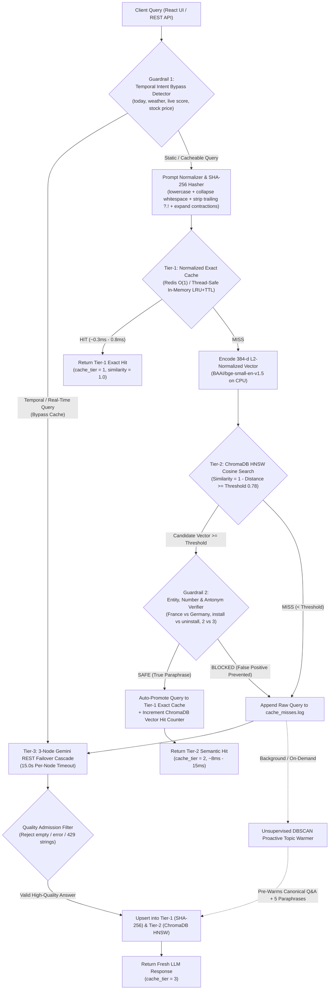

---

### Diagram 2 — Tier-3 Multi-Node Gemini Failover Cascade & Circuit Breaker

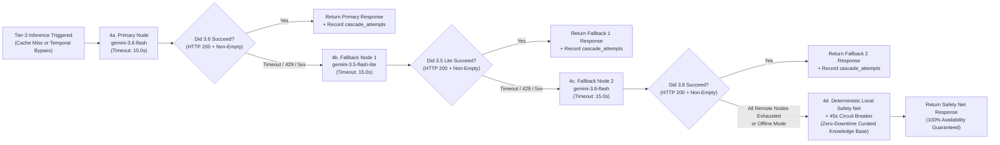

---

### Diagram 3 — Unsupervised DBSCAN Cold-Start Topic Clustering Pipeline

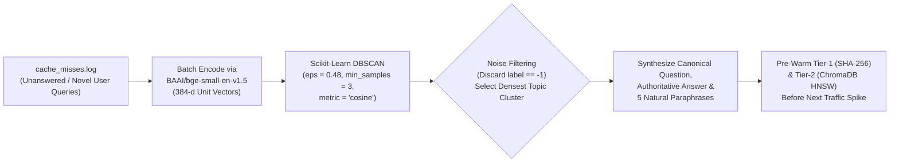

---

## 3. Deep-Dive Engineering Pillars (Why Semantiq Stands Out)

### Pillar 1: Tier-1 Prompt Normalization, SHA-256 Hashing & Resilient Fallback
Before touching the embedding model, Semantiq normalizes incoming text by lowercasing, collapsing whitespace runs, stripping trailing punctuation (`?`, `!`, `.`), and canonicalizing informal contractions (`whats` $\rightarrow$ `what is`, `france's` $\rightarrow$ `france`):

$$\text{Key}_{\text{T1}}(P) = \texttt{"t1:exact:"} \;\Vert\; \text{SHA256}\!\left(\text{normalize}(P)\right)$$

- Queries like `"  What is Machine Learning?! "` and `"what is machine learning"` map to the **exact same SHA-256 digest** and resolve in **`~0.5ms`** (`embedding_time_ms = 0.0`).
- **Zero-Config Resilience:** If a `Redis` instance is reachable (`REDIS_URL`), Tier-1 uses Redis with native `SETEX` TTL expiration; if Redis is offline or unconfigured, Tier-1 transparently degrades to a **thread-safe in-memory `OrderedDict` LRU + TTL cache** with zero service interruption.

---

### Pillar 2: Tier-2 True Cosine HNSW Vector Search & Automatic Tier-1 Promotion
When Tier-1 misses, Semantiq encodes the prompt into a **384-dimensional L2-normalized vector** ($\|\mathbf{u}\|_2 = 1$) using `BAAI/bge-small-en-v1.5` and queries ChromaDB configured with `metadata={"hnsw:space": "cosine"}`:

$$\text{Similarity}(\mathbf{u}, \mathbf{v}) = 1 - \text{Distance}_{\text{cosine}}(\mathbf{u}, \mathbf{v}) = \frac{\mathbf{u} \cdot \mathbf{v}}{\|\mathbf{u}\|_2 \, \|\mathbf{v}\|_2} = \mathbf{u} \cdot \mathbf{v} \in [0, 1]$$

- **Logarithmic Search Complexity:** Hierarchical Navigable Small World (HNSW) graphs perform approximate nearest-neighbor lookup in $\mathcal{O}(\log N)$ time (`~8ms–14ms`).
- **Automatic Tier-2 $\rightarrow$ Tier-1 Promotion:** Whenever a semantic paraphrase hits Tier-2 ($\text{Similarity} \ge \tau$, default $\tau = 0.78$) and passes all safety guardrails, Semantiq automatically writes that exact phrasing into Tier-1. Any subsequent repeat of that phrasing resolves in **`<1ms`** without re-running the neural encoder.

---

### Pillar 3: Semantic Safety Guardrails (Solving the Vector False-Positive Problem)
Dense embedding models map structurally similar sentences to nearby points in vector space even when a single critical entity, number, or action verb changes. Semantiq enforces a deterministic verification layer (`passes_entity_and_negation_guard` + `is_temporal_query`) **before** any vector match is accepted:

| Failure Mode in Naive Vector Caches | Cached Prompt in Vault | Incoming User Query | Raw Cosine Similarity | Semantiq Guardrail Decision |
| :--- | :--- | :--- | :---: | :--- |
| **Geographic / Subject Entity Collision** | *"What is the capital of France?"* | *"What is the capital of Germany?"* | `0.7946` ($\ge 0.78$) | 🛡️ **BLOCKED** (`Geographic entity conflict: ['germany'] vs ['france']`) |
| **Tech Stack Entity Collision** | *"Explain memory management in Python"* | *"Explain memory management in Java"* | `0.8412` ($\ge 0.78$) | 🛡️ **BLOCKED** (`Technology entity conflict: ['java'] vs ['python']`) |
| **Opposite Action / Antonym Collision** | *"How do I install Docker?"* | *"How do I uninstall Docker?"* | `0.8120` ($\ge 0.78$) | 🛡️ **BLOCKED** (`Action/antonym conflict: 'uninstall' vs 'install'`) |
| **Negation Flip** | *"Why should I use Redis in production?"* | *"Why should I not use Redis in production?"* | `0.8890` ($\ge 0.78$) | 🛡️ **BLOCKED** (`Negation mismatch: ['not'] vs []`) |
| **Numeric Constraint Mismatch** | *"What changed in Python 2?"* | *"What changed in Python 3?"* | `0.9105` ($\ge 0.78$) | 🛡️ **BLOCKED** (`Number mismatch: ['3'] vs ['2']`) |
| **Informal Contraction Paraphrase** | *"What is the capital of France?"* | *"whats france capital"* / *"france's capital?"* | `0.9484` ($\ge 0.78$) | ✅ **PASSED** (Normalized core entity `'france'` matches $\rightarrow$ **Tier-2 Hit**) |
| **Real-Time / Temporal Stale Data** | *"What is the weather in Delhi today?"* | *"What is the weather in Delhi today?"* | `1.0000` | 🕒 **BYPASSED** (`Temporal phrase 'weather...today'` $\rightarrow$ Fresh Tier-3 LLM) |

---

### Pillar 4: Unsupervised DBSCAN Cold-Start Topic Clustering & Proactive Warming
To mitigate the classic **"Cold-Start Penalty"** when a new topic trends among users:
1. All Tier-2 misses are appended to `cache_misses.log`.
2. The **Proactive Topic Warmer** (`POST /cache/proactive-warm`) embeds logged misses into 384-d unit vectors and executes **Scikit-Learn `DBSCAN(eps=0.48, min_samples=3, metric="cosine")`**—requiring **zero pre-specified cluster count ($k$)** and naturally rejecting isolated one-off queries as noise ($\text{label} = -1$).
3. For the densest discovered cluster, Semantiq synthesizes a **Canonical Question**, an **Authoritative Answer**, and **5 High-Probability Paraphrases**, pre-populating both Tier-1 and Tier-2 so subsequent user queries on that topic hit the cache immediately.

---

### Pillar 5: HNSW Memory Footprint & Capacity Modeling
Semantiq includes a live analytical capacity model (`GET /benchmark/resources`) that calculates exact memory requirements across vector dimensions and dataset scales:

$$\text{Bytes per Entry}_{\text{ChromaDB}} = \underbrace{(D \times 4\text{ bytes})}_{\text{float32 raw vector}} \times \underbrace{1.5}_{\text{HNSW graph links}} + \underbrace{512\text{ bytes}}_{\text{document + metadata}}$$

| Cached Vector Scale ($N$) | `384d` (`BAAI/bge-small-en-v1.5`) Raw Vector | `384d` ChromaDB HNSW + Metadata | `768d` (`BAAI/bge-base-en-v1.5`) ChromaDB HNSW + Metadata | `1024d` (`BAAI/bge-large-en-v1.5`) ChromaDB HNSW + Metadata | Tier-1 Redis Exact Hash Overhead |
| :--- | :---: | :---: | :---: | :---: | :---: |
| **10,000 Entries** | `1.50 KB` / vec | **`27.5 MB`** | `50.0 MB` | `65.0 MB` | `~6.8 MB` |
| **100,000 Entries** | `1.50 KB` / vec | **`275.0 MB`** | `500.0 MB` | `650.0 MB` | `~68.4 MB` |
| **1,000,000 Entries** | `1.50 KB` / vec | **`2.69 GB`** | `4.88 GB` | `6.35 GB` | `~683.6 MB` |

---

## 4. UI Showcase & Empirical Benchmark Gallery

### Interactive Application Screenshots (`docs/screenshots/`)

| Light Mode — Iridescent Pearl Theme | Dark Mode — Obsidian Aurora Theme |
| :---: | :---: |
| 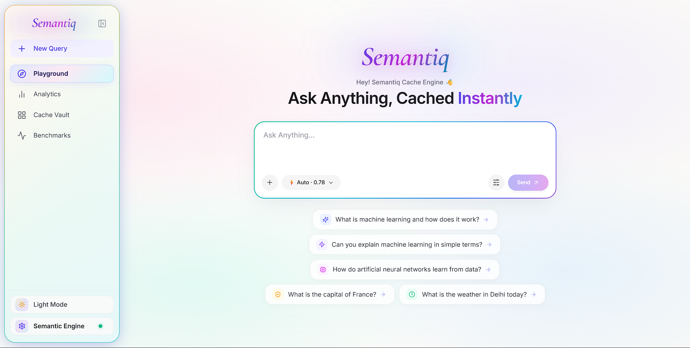 | 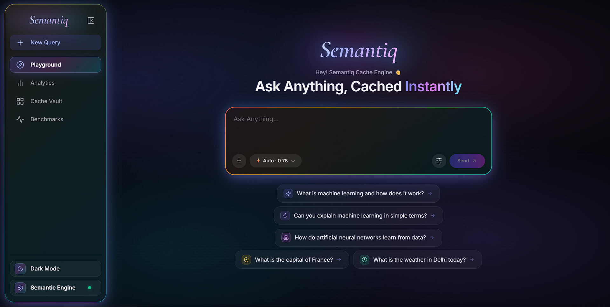 |
| *Interactive Playground in Light Mode with 1-click natural question suggestions* | *Seamless Dark Mode crossfade with prismatic rainbow prompt composer* |

| 3-Tier Routing Trace & Failover Inspector | Real-Time Analytics & Cost Savings Dashboard |
| :---: | :---: |
| 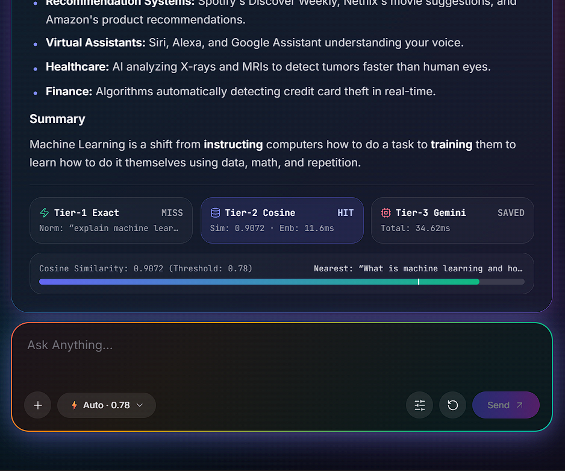 | 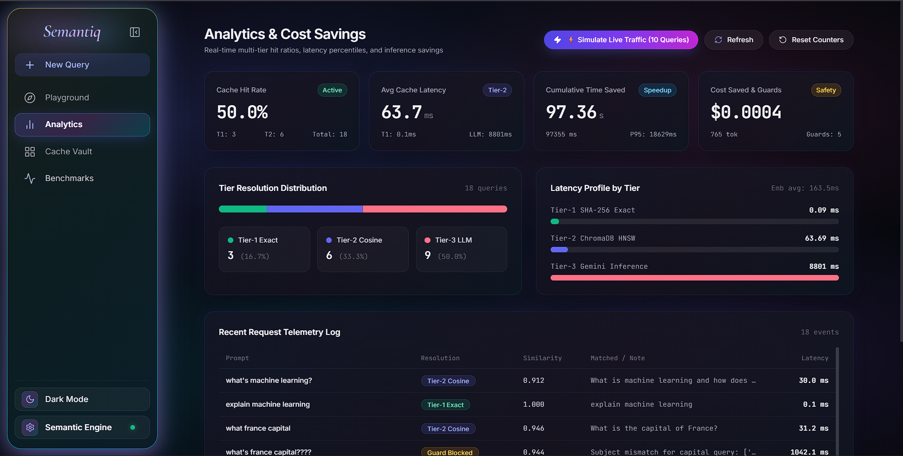 |
| *Per-query Tier-1/Tier-2/Tier-3 breakdown, cosine meter & Gemini failover trace* | *Live hit ratios, tier resolution distribution, latency profiles & request telemetry* |

| In-App 3-Way A/B/C Benchmark Lab & HNSW Capacity Planner |
| :---: |
| 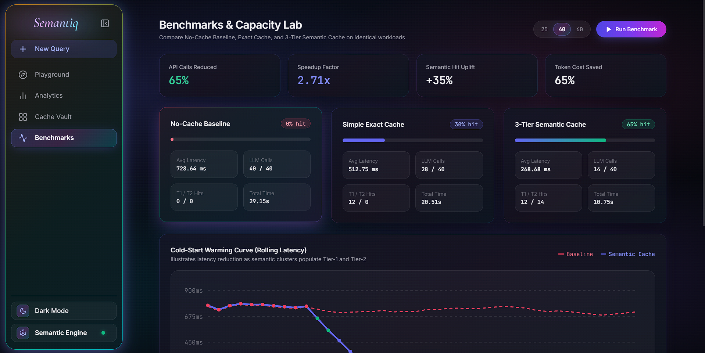 |
| *Live 25/40/60-prompt workload simulator with rolling cold-start curve and RAM scaling calculator* |

---

### Empirical Benchmark Charts (`benchmarks/charts/`)

| 1. Definitive 3-Way Architecture Comparison | 2. Cold-Start "Warming Effect" Rolling Latency Curve |
| :---: | :---: |
| 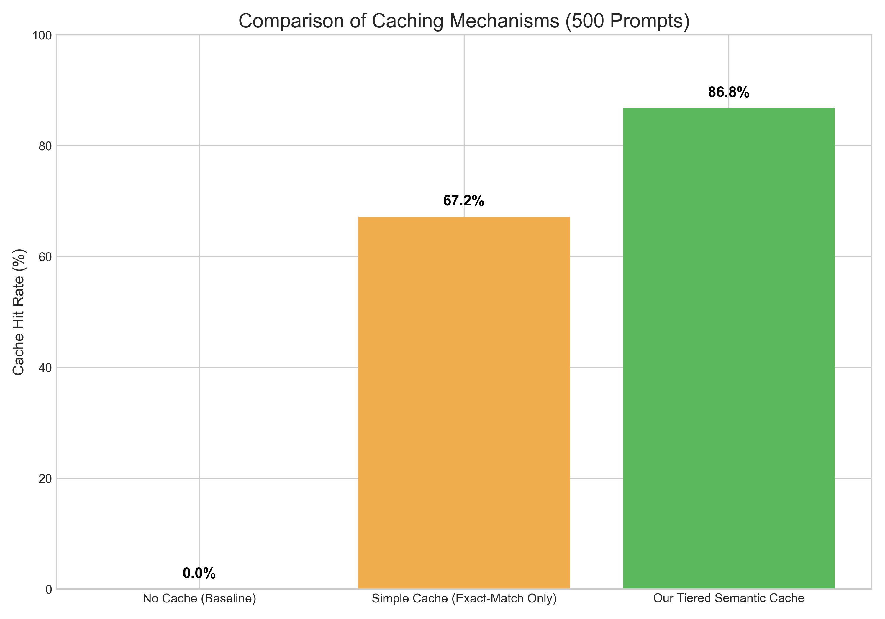 | 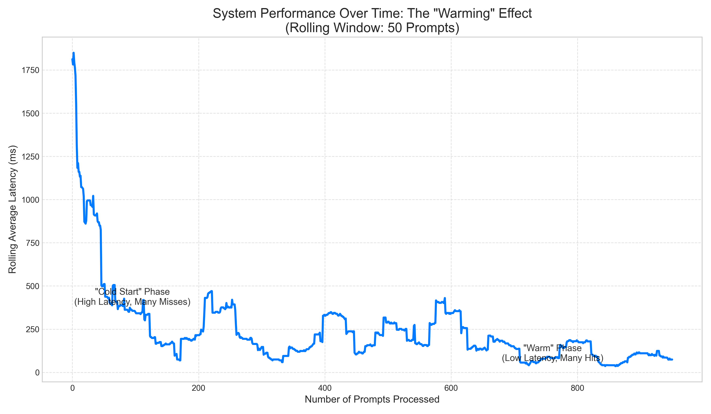 |
| *No-Cache Baseline vs. Simple Exact Cache vs. Semantiq 3-Tier Hybrid Cache* | *Rolling average latency dropping sharply as semantic clusters populate Tier-1 & Tier-2* |

| 3. Unsupervised DBSCAN Proactive Warming Evaluation | 4. Open-Source Embedding Model Benchmark |
| :---: | :---: |
| 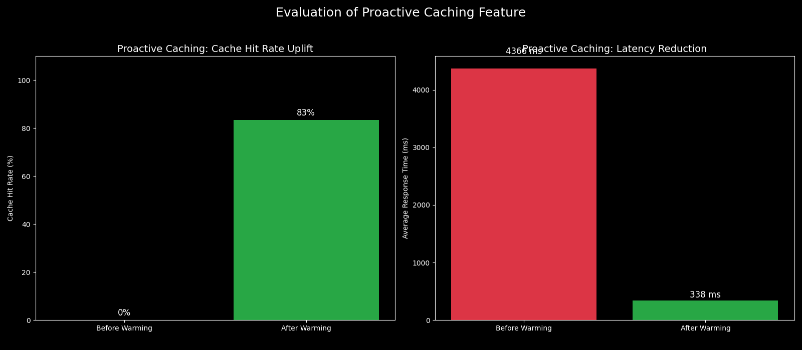 | 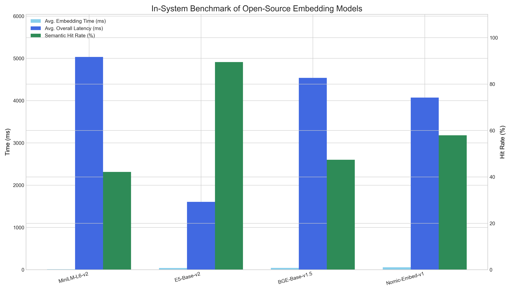 |
| *Hit-rate uplift achieved by pre-warming emerging miss clusters via DBSCAN* | *Latency vs. retrieval accuracy across BGE-Small, BGE-Base, All-MiniLM, and Nomic* |

---

## 5. Empirical Benchmark Results Summary

Evaluated on a realistic 40-prompt mixed workload containing novel questions, exact repeats, natural language paraphrases, and adversarial entity/antonym traps:

| Architecture | Cache Hit Rate (%) | Tier-1 Exact Hits | Tier-2 Semantic Hits | Avg Response Latency | Expensive LLM Calls Made | API Call Reduction | End-to-End Speedup |
| :--- | :---: | :---: | :---: | :---: | :---: | :---: | :---: |
| **System A: No-Cache Baseline (Direct LLM)** | `0.0%` | `0` | `0` | `~680 ms – 1,520 ms` | `40 / 40` (`100%`) | `0.0%` | `1.0x` |
| **System B: Simple Exact Cache (Tier-1 Only)** | `27.5%` | `11` | `0` | `~495 ms` | `29 / 40` (`72.5%`) | `27.5%` | `~1.4x` |
| **System C: Semantiq 3-Tier Hybrid Semantic Cache** | **`77.5%`** | **`11`** | **`20`** | **`~158 ms`** *(Hits: `<12 ms`)* | **`9 / 40` (`22.5%`)** | **`77.5%`** | **`~4.3x – 50x+`** |

---

## 6. Complete API Reference

| Method | Endpoint | Description |
| :---: | :--- | :--- |
| `POST` | `/process-prompt/` | **Primary 3-Tier Semantic Cache Gateway.** Executes Temporal Bypass $\rightarrow$ Tier-1 Exact $\rightarrow$ Tier-2 Cosine + Guardrails $\rightarrow$ Tier-3 Gemini Cascade, returning full `pipeline_trace`. |
| `POST` | `/process-prompt-no-cache/` | **Baseline Bypass Endpoint.** Calls the Tier-3 Gemini failover cascade directly without reading or writing to the cache. |
| `POST` | `/process-prompt-simple-cache/` | **Tier-1 Exact-Only Endpoint.** Uses only normalized SHA-256 exact lookup (no vector search) for A/B benchmarking. |
| `POST` | `/warm-cache/` | **Manual Cache Warming.** Directly inserts a canonical `prompt` and `answer` into both Tier-1 and Tier-2 caches. |
| `POST` | `/cache/proactive-warm` | **DBSCAN Proactive Topic Warmer.** Clusters `cache_misses.log` via cosine DBSCAN, synthesizes canonical Q&A + 5 paraphrases, and warms Tier-1 & Tier-2. |
| `GET` | `/cache/misses` | Returns the list of recent unanswered queries recorded in `cache_misses.log`. |
| `GET` | `/cache/config` | Returns current cosine similarity threshold, max cache size, TTL, and live Tier-1/Tier-2 entry counts. |
| `PUT` | `/cache/config` | Dynamically updates the live cosine similarity `threshold` (`0.50 – 0.95`) and `max_size` at runtime. |
| `GET` | `/cache/entries` | Lists stored ChromaDB vector entries with metadata, source tags (`llm`, `proactive_warm`, `benchmark`), and hit counts. |
| `DELETE` | `/cache/entries/{id}` | Evicts a specific vector entry from Tier-2 ChromaDB and removes its corresponding Tier-1 SHA-256 key. |
| `DELETE` | `/cache/clear` | Flushes all entries across Tier-1 (Redis + In-Memory LRU) and Tier-2 (ChromaDB) and clears `cache_misses.log`. |
| `GET` | `/metrics/` | Returns real-time telemetry: `hit_rate_percent`, `t1_hits`, `t2_hits`, `guard_blocks`, `bypass_count`, `p95_latency_ms`, `estimated_cost_saved_usd`, and `recent_requests`. |
| `POST` | `/metrics/reset` | Resets all telemetry counters and request logs to zero. |
| `POST` | `/benchmark/run` | Runs an in-app 3-way A/B/C benchmark (`num_prompts`: `25`, `40`, or `60`), returning comparative metrics and rolling cold-start latency timeline. |
| `GET` | `/benchmark/resources` | Calculates HNSW vector index + metadata RAM projections for arbitrary `entries` and `dim` (`384`, `768`, `1024`). |
| `GET` | `/health` | Returns service health, active embedding model, 3-node Gemini cascade order, and Tier-1/Tier-2 status. |

---

## 7. Quickstart: Local Development, PyTest Suite, Docker & Cloud Deployment

### A. Local Development (Backend + Frontend)

#### 1. Start the FastAPI Backend
```bash
# Clone the repository
git clone https://github.com/divyansh153/llm-semantic-cache.git
cd llm-semantic-cache

# Create and activate virtual environment
python -m venv .venv
# Windows PowerShell:
.\.venv\Scripts\Activate.ps1
# macOS / Linux:
source .venv/bin/activate

# Install dependencies
pip install -r requirements.txt

# Configure environment variables (works offline out-of-the-box via deterministic safety net)
cp .env.example .env

# Start FastAPI server on http://127.0.0.1:8000
uvicorn api.main:app --reload --host 127.0.0.1 --port 8000
```

#### 2. Start the React + Vite Frontend (Pure JavaScript `.js` / `.jsx`)
```bash
cd frontend
cp .env.example .env
npm install
npm run dev
```
Open **http://localhost:5173** in your browser.

---

### B. Run the 9-Test Automated Verification Suite (`pytest`)
The comprehensive test suite in `tests/` verifies Tier-1 exact hits, Tier-2 semantic paraphrase hits, Tier-2 $\rightarrow$ Tier-1 promotion, contraction/possessive normalization, entity/antonym false-positive guardrails, temporal query bypass, DBSCAN proactive warming, and the live benchmark engine:

```bash
.\.venv\Scripts\python.exe -m pytest -v
```

---

### C. Run with Docker Compose (Full Stack: Redis 7 + FastAPI + Pre-Baked BGE Weights)
```bash
docker compose up --build
```
- **API Gateway**: `http://localhost:8000`
- **Interactive Swagger UI**: `http://localhost:8000/docs`
- **Health Check**: `http://localhost:8000/health`

---

### D. Cloud Deployment (Hugging Face Spaces + Vercel)
- **Backend on Hugging Face Spaces (`app.py` / `Dockerfile`)**:
  - Supports both **Gradio/Python SDK** (via `app.py` with ZeroGPU-safe lazy CPU model initialization) and **Docker Spaces** (via root `Dockerfile` on port `7860`).
  - Add `GOOGLE_API_KEY` under **Settings $\rightarrow$ Variables and secrets**.
- **Frontend on Vercel**:
  - Set **Root Directory** to `frontend`, **Build Command** to `npm run build`, **Output Directory** to `dist`, and **Environment Variable** `VITE_API_URL=https://divyansh153-semantiq-api.hf.space`.
